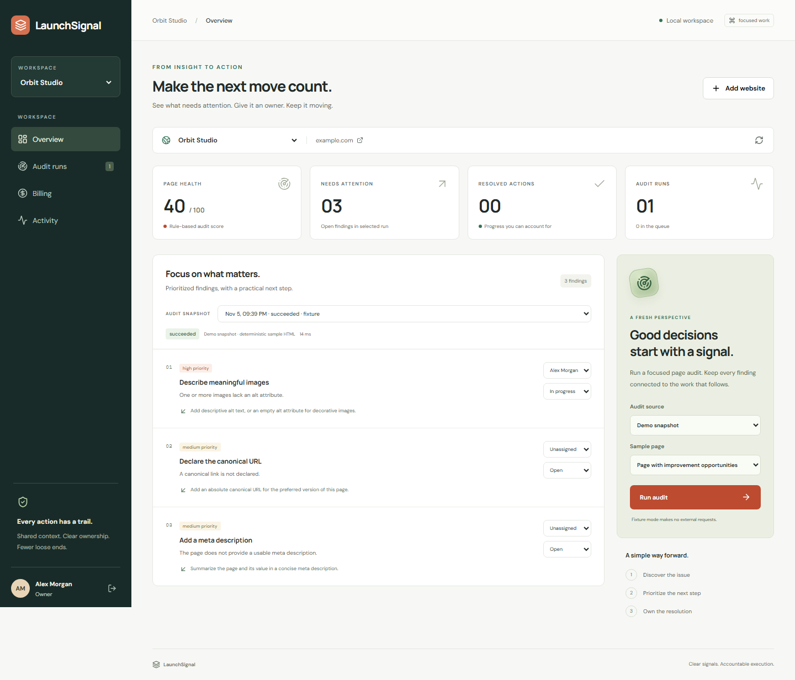
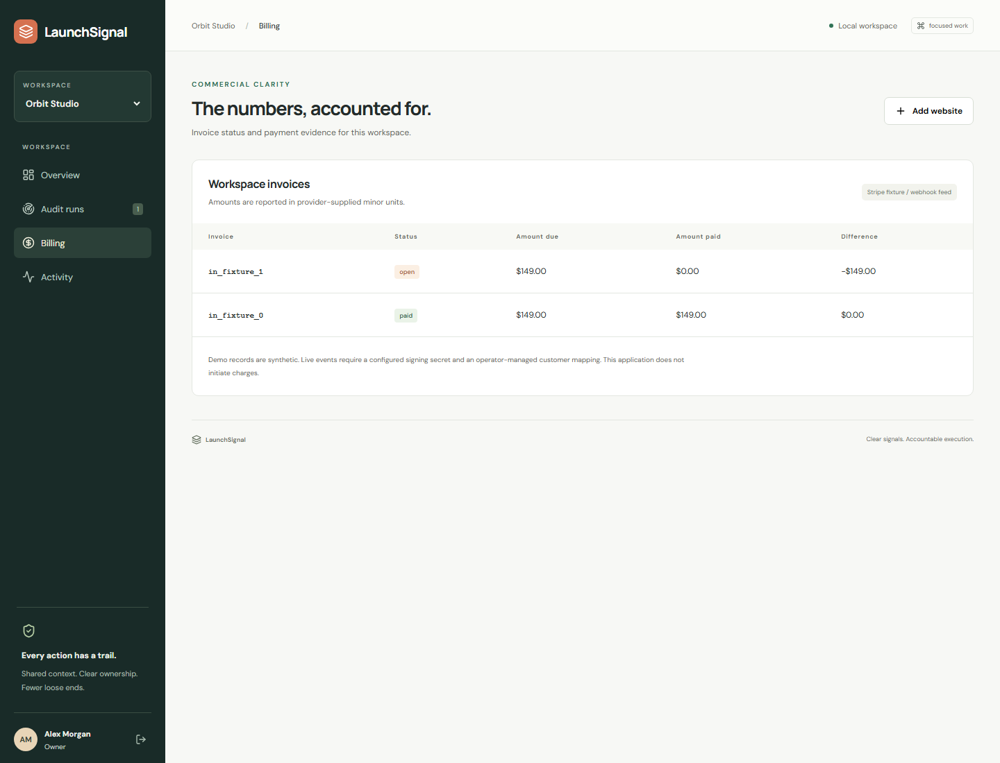
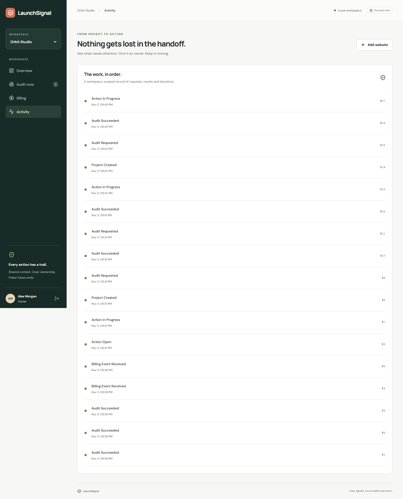
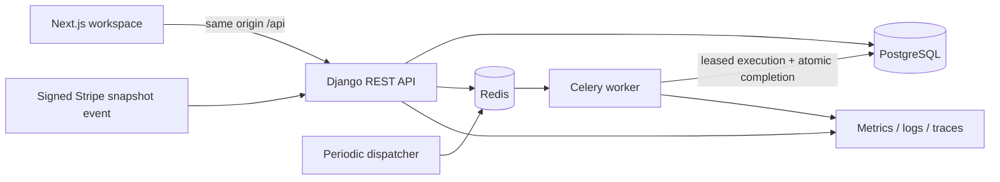

# LaunchSignal

**Website findings, owned through resolution.**

LaunchSignal is a marketing operations workspace for teams managing multiple websites. It connects a focused page audit to prioritized findings, a named owner, a resolution status and a workspace activity trail. Invoice and payment evidence sit alongside delivery, so operational and commercial context stay together.

[](https://github.com/the-devcraft/launchsignal/actions/workflows/ci.yml)



## Why this exists

An audit report identifies a problem. It rarely records who will act on it, whether the work is moving, or what evidence supports the next decision. LaunchSignal explores that handoff: **finding → owner → action → follow-up snapshot**, within a tenant-scoped workspace.

The scope is deliberately narrow. This is an original, runnable portfolio application with explainable audit rules, durable background jobs and payment-event handling. It does not claim production customers, search-ranking improvements or a new market category.

## What works

- **Isolated workspaces:** owner, editor and viewer roles; membership checked on every scoped request. Billing is owner-only.
- **Page audits:** real Celery delivery, persisted job records, retry budgets and expiring leases with fencing tokens. An unavailable broker cannot erase an accepted job.
- **Actionable findings:** five documented HTML checks, member assignment, explicit status changes and optimistic version checks to prevent lost updates.
- **Payment evidence:** Stripe snapshot webhook signatures, exact replay detection, atomic invoice updates, out-of-order delivery handling and authoritative customer-to-workspace mappings. All amounts use integer minor units.
- **Operational visibility:** JSON request/worker logs, request IDs, OpenTelemetry traces, protected Prometheus metrics, optional Sentry and a provisioned Grafana/Loki/Tempo/Mimir/Alloy profile.
- **A usable interface:** Next.js, TypeScript, responsive layouts, keyboard-friendly controls and automated accessibility checks.

### Billing and activity

| Workspace billing | Delivery activity |
| --- | --- |
|  |  |

Screenshots are captured from the running application using synthetic demo data. [Mobile view](docs/screenshots/mobile.png).

## Run locally

Requires Docker Engine with Compose v2. Copy `.env.example` to `.env` and fill the five required secrets. Use URL-safe random values for `POSTGRES_PASSWORD` because it is embedded in `DATABASE_URL`; use at least 12 characters for `DEMO_PASSWORD`.

With Python installed, `python scripts/setup_env.py` generates those local secrets without overwriting an existing `.env` or printing secrets. Then skip the manual copy/edit step below.

```sh
cp .env.example .env
# Fill POSTGRES_PASSWORD, DJANGO_SECRET_KEY, DEMO_PASSWORD,
# METRICS_TOKEN and GRAFANA_PASSWORD with local-only values.
docker compose up --build -d
docker compose --profile tools run --rm seed
```

Open **http://localhost:3000**. Sign in as `demo@launchsignal.test` with your configured `DEMO_PASSWORD`. Select **Orbit Studio** to explore the seeded findings and invoices. Seeding is transactional and preserves existing demo data and credentials on subsequent runs.

Fixture mode makes no external requests. Live mode requires exact hostnames in `AUDIT_ALLOWED_HOSTS`; it validates public DNS addresses, pins the validated IP while preserving TLS hostname verification, rejects redirects and caps response size. It audits one HTML response, without browser rendering or recursive crawling.

For observability, set `OTEL_EXPORTER_OTLP_ENDPOINT=http://tempo:4318` in `.env`, then run:

```sh
docker compose --profile observability up --build -d
```

Grafana runs at **http://localhost:3001**, username `admin`, password from `GRAFANA_PASSWORD`. The provisioned **LaunchSignal / Operations** dashboard links metrics, logs and traces. This Compose configuration is for local evaluation; [deployment requirements](docs/security.md) apply before internet exposure.

## Engineering map

| Layer | Implementation |
| --- | --- |
| API | Python, Django 5.2, Django REST Framework, session authentication and CSRF |
| Persistence | PostgreSQL, uniqueness constraints, row locks, transactional event recording |
| Background work | Celery, Redis, periodic dispatch, bounded retry and fenced completion |
| Interface | React, Next.js, TypeScript |
| Payments | Stripe signature verification and invoice-event projection; no charge initiation |
| Operations | Docker Compose, GitHub Actions, Sentry, OpenTelemetry, Grafana stack |



## Verification

```sh
python -m venv .venv
# Activate .venv, then:
pip install -r requirements.lock
# Set DJANGO_SECRET_KEY, DATABASE_URL (PostgreSQL), DJANGO_DEBUG=true,
# and CELERY_BROKER_URL (Redis; memory:// is supported for local tests).
python backend/manage.py migrate
pytest
ruff check backend && ruff format --check backend
python backend/manage.py makemigrations --check --dry-run
cd frontend
pnpm install --frozen-lockfile --ignore-scripts
pnpm typecheck && pnpm lint && pnpm build
# With the seeded app running and DEMO_PASSWORD exported:
pnpm exec playwright install chromium
pnpm test:e2e
```

CI runs PostgreSQL-backed tests on Python 3.12 and 3.13, Redis worker delivery, frontend checks, dependency audits, a full Compose build, browser flows and telemetry ingestion checks. See [verification evidence](docs/verification.md) for observed results and limits.

## Design decisions and boundaries

- Shared-schema tenancy is enforced by API scoping and tested across roles and endpoints; it is not PostgreSQL row-level security.
- Marking a finding resolved is a human workflow decision. Only a subsequent audit provides a new rule result; resolution never silently changes a historic score.
- The five checks are HTML hygiene rules, not a comprehensive SEO score, accessibility audit or Lighthouse replacement.
- Billing is a webhook-driven projection, not a general ledger, subscription engine, checkout or bank reconciliation service. Demo invoices are synthetic.
- Lists have explicit upper bounds; large-account pagination, SSO, invitations, email delivery and account self-service are outside this release.

[Architecture and tradeoffs](docs/architecture.md) · [API contract](docs/api.md) · [Security](docs/security.md) · [Operations runbook](docs/operations.md) · [Development notes](docs/development.md)

MIT licensed. See [LICENSE](LICENSE).
